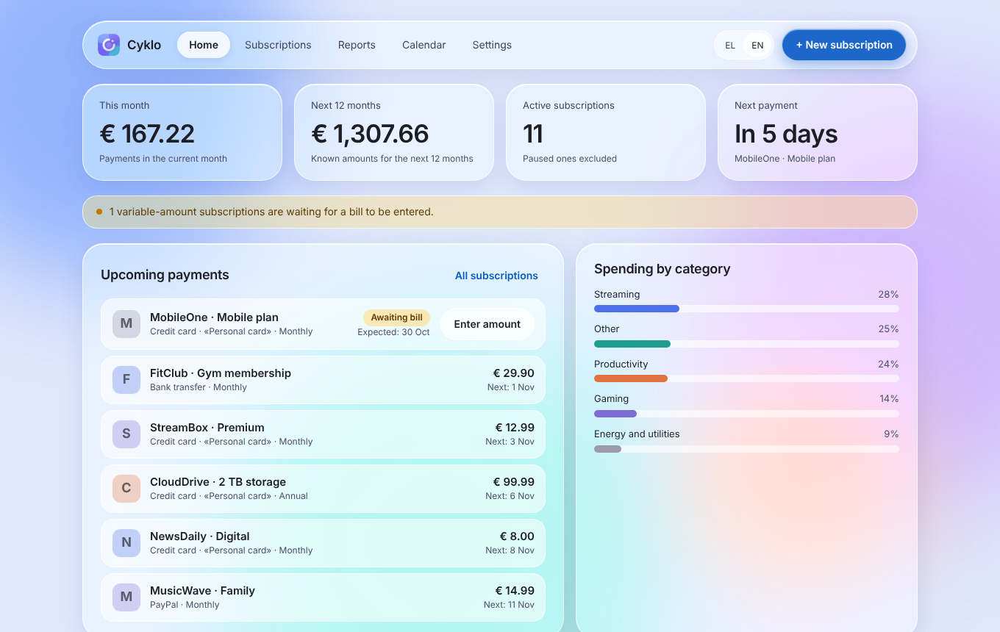
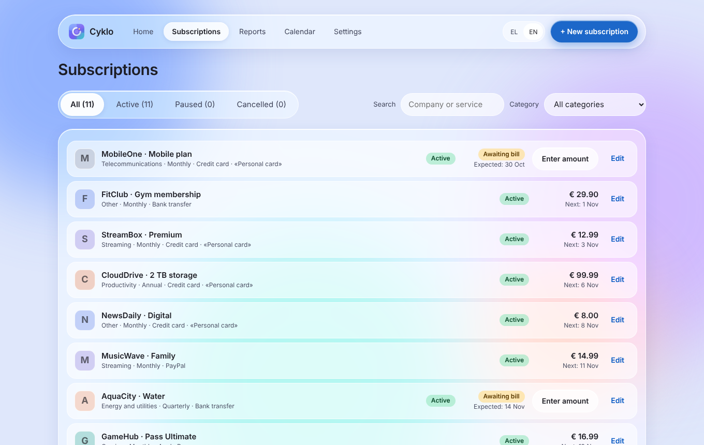
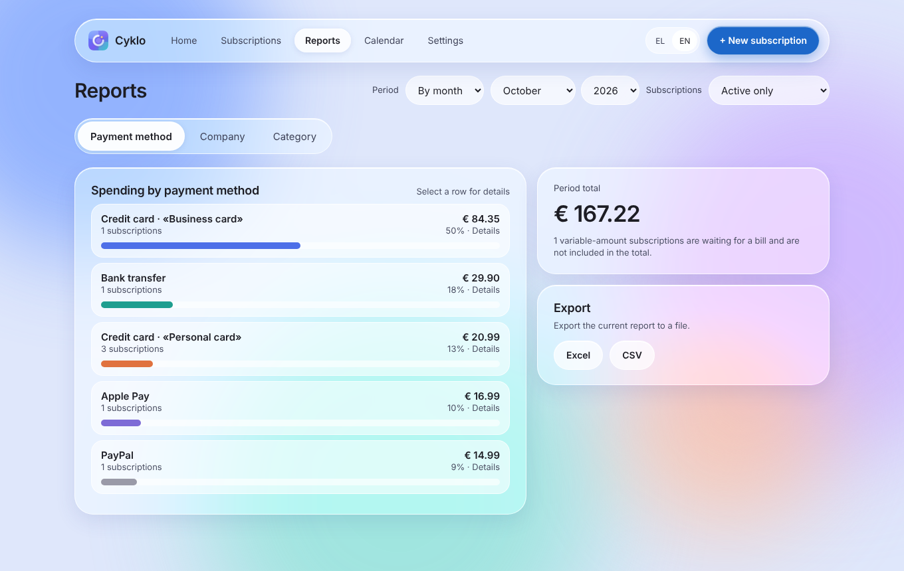
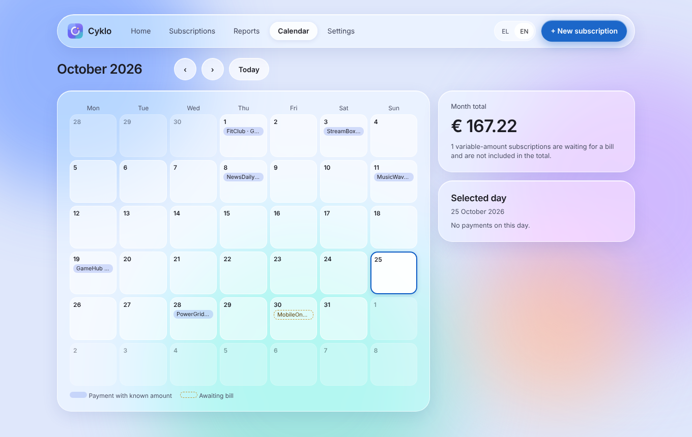
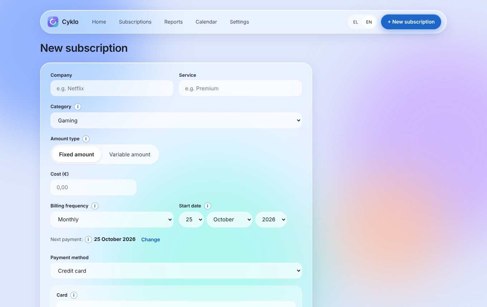
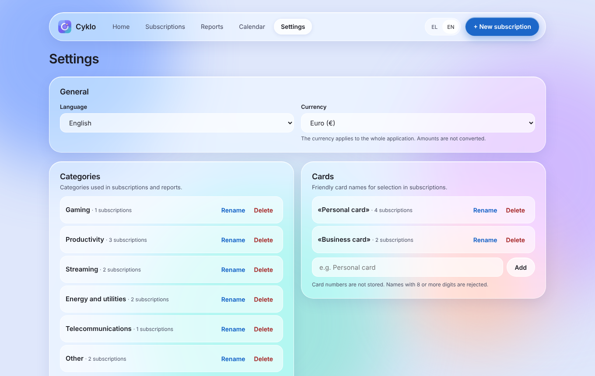

# Cyklo (cyklosub)

Subscription and recurring-bill manager for Synology DSM, packaged as an SPK.
Greek and English interface, one user per installation.

**Provided "as is", without warranty of any kind** (see [LICENSE](LICENSE)). It has been tested by its author on a single Synology DS-918+ with DSM 7.4. Make a backup (Settings → Backups) before every update.

## Features
- Fixed-amount subscriptions and variable-amount recurring bills (amount entered per bill)
- Monthly and 12-month totals, reports by payment method, company and category, payment calendar
- Custom categories and payment methods; card friendly names only (no card numbers are stored)
- Reminders through Pushover
- Excel/CSV export, backup and restore

Not working yet: email reminders (hidden), DSM login (removed). The app has no login of its own: reach it only from a trusted network (LAN or VPN such as Tailscale).

## Screenshots
Sample data only; the companies shown are fictional.

## Documentation
[User Guide](docs/USER_GUIDE.md) (English)

## Install
1. Download `cyklosub-<version>.spk` from the Releases page.
2. DSM → Package Center → Manual Install → select the file.
3. Open Cyklo from the DSM desktop, or `http://<NAS address>:8765/`.

The package declares `arch="x86_64 apollolake"`. Other platforms are untested.

### Container (Docker) edition
For those without a Synology NAS, an alternative container image for x86_64 hosts is described in [docs/DOCKER.md](docs/DOCKER.md): `docker compose up -d` with the included `docker-compose.yml`. The author does not use it and has not tested it.

## Repository
- `app/` – Go server and web interface
- `packaging/` – SPK files; `packaging/build.sh` builds the package
- `Dockerfile`, `docker-compose.yml`, `.github/workflows/docker.yml` – container edition
- `design/`, `assets/` – UI prototype boards and app icon
- `CHANGELOG.md` – release notes (also shown inside the app after an update)

## License
MIT. Pushover is a service of Superblock, LLC; this project is not affiliated with it. Synology and DSM are trademarks of Synology Inc.; this project is not affiliated with Synology.
